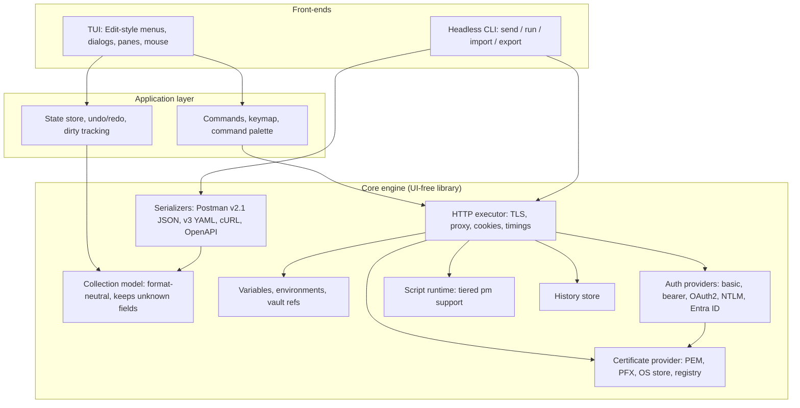

# Terminal REST Client — Solution Proposals for Evaluation

*Prepared 2026‑11‑04. Library versions were checked on this date against crates.io, NuGet (through your feed proxy), the Go module proxy, PyPI, npm, and GitHub. Binary sizes, effort figures, and scores are **estimates**; the spike in §9 will measure them.*

Working name in this doc: **TermRest** (a placeholder; rename freely).

---

## 0. TL;DR

| # | Option | One-line verdict |
|---|---|---|
| **A** | **.NET 10 + Terminal.Gui v2** | **Recommended.** Classic Edit-style UI (menu bar, dialogs, mouse) out of the box. Strongest certificate support on all three OSes, including non-exportable Windows keys and the macOS Keychain. Native AOT single binaries. The SDK is already installed. |
| B | Rust + Ratatui | Lightest and fastest (≈5–15 MB). You hand-build most UI behavior. Good certificate support (Windows store via `rustls-cng`), but macOS Keychain needs custom code. |
| C | Go + tview (or Bubble Tea v2) | Easiest six-target builds (pure cross-compile). Decent mouse-aware widgets. Certificate stores via third-party libraries. |
| D | Python + Textual | Fastest prototype and very polished mouse UX. Fails the OS-certificate-store requirement; heavy to distribute. |
| E | Node/TypeScript + Postman's open-source runtime | 100 % Postman script fidelity. Weak TUI options and no OS-store certificates; heaviest binaries. |
| F | Rust + custom Edit-style immediate-mode UI | Exact Microsoft Edit look and a tiny binary, but you build and maintain a UI framework. |
| G | Fork an existing tool (Posting, ATAC, Resterm, Slumber) | None stores Postman format natively, uses OS certificate stores, or has an Edit-style menu UI. Borrow ideas instead of forking. |

**Decisions that apply to every option (§2–§5):**
1. Use Postman **v2.1.0 JSON** as the native on-disk format in v1, because it is the universal interchange format. Add **v3.0.0 YAML** (Postman v12 "Native Git") as a phase-2 read/write format.
2. Keep the model round-trip safe: preserve unknown fields, key order, and IDs, and verify with golden-file tests.
3. Make the certificate subsystem first-class: PEM, PFX, OS stores (including non-exportable keys), a host-matching registry, CA trust, a TLS details view, and optional Entra ID certificate-to-token.
4. Build a UI-free core engine, then a TUI and a headless CLI (`send`, `run`) on top of the same core.

---

## 1. Requirements

| ID | Requirement | Source |
|---|---|---|
| R1 | Full-screen terminal UI like Microsoft Edit: menu bar, dialogs, panes; full mouse (click, wheel, drag, right-click) **and** full keyboard | You |
| R2 | Persist API collections in a Postman-compatible format | You |
| R3 | Certificate-based authentication — **must have** | You |
| R4 | Windows, macOS, Linux on **x64 and ARM64** (6 targets) | You |
| R5 | Lightweight, general purpose, for dev/testing | You |
| A1 | One self-contained binary per target; no runtime prerequisite | Assumed |
| A2 | Postman environments and `{{variables}}` | Assumed |
| A3 | Headless CLI runner for CI using the same engine | Assumed (recommended) |
| A4 | Pre-request/test scripts: always preserved, executed in a later phase | Assumed — see §2.5 |

---

## 2. What "Postman-compatible" means in late 2026

### 2.1 Two official formats now exist

| | **v2.1.0** — JSON, single file | **v3.0.0** — YAML, multi-file |
|---|---|---|
| Status | Default **export** format; the universal interchange format | Current format inside Postman v12 ("Native Git" / Local View) |
| Layout | One `*.postman_collection.json`; environments in `*.postman_environment.json` | A folder is a collection: one `*.request.yaml` per request, a `<request>.resources/` folder (examples, scripts), and `definition.yaml` for collection/folder metadata; ordering via fractional indexes |
| Tooling | Postman import/export, Newman, Insomnia, Bruno, Hoppscotch, Posting, ATAC, … | Postman app and Postman CLI only. **Newman cannot run v3.** |
| Protocols | HTTP (including a GraphQL body mode) | `$kind`: http, graphql, grpc, websocket, socketio, mqtt, kafka, mcp, llm, data |
| Git-friendliness | Poor (one large file); mitigated by deterministic formatting | Excellent |

Both schemas are published at <https://schema.postman.com/>.

**Recommendation**
- **v1:** read and write v2.1.0 JSON as the native format; import v2.0.
- **Phase 2:** read and write v3.0.0 YAML for `http-request` (and `graphql`); preserve other `$kind`s untouched.
- Keep the internal model format-neutral. Serializers are plugins: `postman-v21-json`, `postman-v3-yaml`, `curl`, and later an `openapi` importer.

### 2.2 Round-trip fidelity rules (this decides whether "compatible" holds)
1. Preserve unknown properties at every level (`[JsonExtensionData]` in .NET, `#[serde(flatten)]` maps in Rust, raw-JSON maps in Go).
2. Preserve key order, array order, and IDs (`info._postman_id`, item `id`). Keep any polymorphic shape the user didn't edit: `url` as string or object, `description` as string or object, and `exec` as an array of lines.
3. Edit surgically: change only the nodes the user touched. Regenerate `url.host/path/query/variable` from `url.raw` (as Postman does) only when the URL itself changes.
4. Write deterministically, matching Postman's export style: tab-indented JSON, UTF‑8 without a BOM, LF line endings.
5. Test that import → save produces an empty semantic diff across a corpus of real exports. Validate output against the official JSON Schema in CI.

### 2.3 v2.1 elements to model (verified against the schema)
`info`, `item` / `item-group` (folders), `request` (`url`, `method`, `header`, `body`, `auth`, `proxy`, **`certificate`**, `description`), `response` (saved examples), `event` + `script` (prerequest/test), `variable`, `auth`, `protocol-profile-behavior`, `cookie`, `proxy-config`.

- **Auth types:** `noauth`, `basic`, `bearer`, `apikey`, `digest`, `oauth1`, `oauth2`, `ntlm`, `awsv4`, `hawk`, `edgegrid`. Auth inherits request → folder → collection; `noauth` stops inheritance.
- **Body modes:** `raw` (with `options.raw.language`), `urlencoded`, `formdata`, `file`, `graphql`.
- **TLS-related `protocolProfileBehavior` keys:** `strictSSL`, `tlsDisabledProtocols`, `tlsCipherSelection`, plus `followRedirects`, `disableUrlEncoding`, and others.
- **v3 adds** auth types `jwt`, `asap`, **`azure`**, and `sasl`, plus secret variables sourced from vaults: `postman`, **`azure`** (Key Vault), `aws`, `hashicorp`, `1password`, `passport`. HTTP settings (`strictSSL`, `tlsDisabledProtocols`, `tlsCipherSelection`, …) move under `settings`.

### 2.4 Variables and environments
- **Scopes, lowest to highest precedence:** global → collection → environment → data (runner) → local.
- `{{name}}` resolves in the URL, params, headers, body, and auth fields. **Dynamic variables:** `{{$guid}}`, `{{$timestamp}}`, `{{$isoTimestamp}}`, `{{$randomInt}}`, plus a curated subset of `{{$random*}}`.
- **Environment file shape:** `{ id, name, values: [{ key, value, type: "default"|"secret", enabled }], _postman_variable_scope: "environment" }`.
- **Secrets:** support Postman-style `{{vault:name}}` references, resolved from the OS secret store (Windows Credential Manager, macOS Keychain, Linux Secret Service). Never write secret values into collection files.

### 2.5 Scripts (`pm.*`): choose a tier

| Tier | What it does | Fidelity | Cost |
|---|---|---|---|
| **T0 (MVP)** | Preserve `event` scripts verbatim, editable in a Scripts tab, with a "not executed" banner | Lossless storage | ≈0 |
| **T1** | No-code assertions and extractors in the UI that **generate standard `pm` code** (`pm.test(...)`, `pm.environment.set(...)`), so Postman and Newman run them identically | High for generated code | Low |
| **T2** | Embedded JS engine plus a `pm` shim: variables API, `pm.request`/`pm.response`, `pm.test`, `pm.expect` (bundled chai.js), `pm.sendRequest`, and common `require()` libraries (crypto-js, lodash, uuid, moment) | ≈80–90 % of real-world scripts | Medium–high |
| **T3** | "Run with Newman / Postman CLI" escape hatch when either is installed | 100 % | Low |

**Embeddable JS engines:** .NET → Jint; Rust → rquickjs (QuickJS-ng) or boa_engine; Go → goja; Python → QuickJS bindings; Node → native (`postman-sandbox`).

### 2.6 Things Postman keeps outside the collection (so should we)
Client certificates, CA certificates, proxy settings, the SSL-verification default, cookies, and history all live in workspace/app settings files, not in the collection (see §5.3).

---

## 3. Certificate-based authentication (must have)

### 3.1 Scenarios

| ID | Scenario | Proposed priority |
|---|---|---|
| C1 | mTLS with a PEM certificate + key (encrypted PKCS#8 key, intermediate chain) | Must |
| C2 | mTLS with a PFX/P12 file + passphrase | Must |
| C3 | mTLS with an **OS-store identity**: Windows `CurrentUser\My` / `LocalMachine\My` by thumbprint or subject, **including non-exportable keys (CNG, TPM, smart card)**; macOS Keychain identities | Must on Windows (assumed); Should on macOS |
| C4 | Linux: files (PEM/PFX); PKCS#11 tokens (smart card/HSM) | Must (files) / Could (PKCS#11) |
| C5 | Server trust: OS trust store by default; extra CA bundle (private/corporate CAs); per-request `strictSSL: false`; show the server chain and expiry | Must |
| C6 | Certificate → token: Entra ID client-credentials with a certificate assertion (including SN+I / `x5c`), token cache with auto-refresh, injected as a bearer token; generic OAuth2 `private_key_jwt` | Should (high value for Azure/first-party service testing) |
| C7 | Client-certificate prompt: when a server requests a certificate and none matches, open a picker filtered by the server's acceptable issuers | Should |

### 3.2 Configuration model
- **Per request (spec-native in v2.1):** `request.certificate` → `{ name, matches[], cert{src}, key{src}, passphrase }`. Honor it on load; write it only if the user sets it.
- **Workspace certificate registry**, modeled on Postman's Settings → Certificates and Newman's `--ssl-client-cert-list` format. File: `.termrest/certificates.json`.

```jsonc
[
  { "name": "contoso-dev", "matches": ["https://*.contoso-dev.example/*"],
    "cert": { "src": "certs/client.pem" }, "key": { "src": "certs/client.key" },
    "passphrase": "{{vault:contoso-key-pass}}" },
  { "name": "partner", "matches": ["https://api.partner.example:8443/*"],
    "pfx": { "src": "certs/partner.pfx" }, "passphrase": "{{vault:partner-pfx}}" },
  { "name": "svc-identity", "matches": ["https://*.internal.example/*"],
    "x-store": { "location": "CurrentUser", "store": "My", "thumbprint": "4F2A…C91B" } }
]
```

  File-based entries stay Newman-compatible; `x-store` is our extension.
- **Resolution order:** request `certificate` → most specific registry match (scheme + host + port + path) → interactive picker (C7) → none.
- **UI:**
  - A Certificates manager: list, add from file or pick from the OS store, expiry warnings, and a "Test handshake" button.
  - A status-bar indicator showing which certificate was presented.
  - A **TLS** tab in the response view: protocol, cipher, ALPN, server chain, and the client certificate used.

### 3.3 Capability by stack

| Capability | .NET 10 | Rust | Go | Python | Node |
|---|---|---|---|---|---|
| C1 PEM (+ encrypted key) | ✅ built in (`X509Certificate2.CreateFromEncryptedPemFile`) | ✅ rustls + `pkcs8` | ✅ `crypto/tls` (encrypted PKCS#8 needs a library) | ✅ `ssl.load_cert_chain` | ✅ `tls` options |
| C2 PFX | ✅ `X509CertificateLoader.LoadPkcs12FromFile` | ✅ `p12-keystore` 0.4 | ✅ `go-pkcs12` 0.7 | ⚠️ `cryptography` → temporary PEM file | ✅ `pfx` option |
| C3 Windows store, non-exportable keys | ✅ native (SChannel/CNG) | ✅ `rustls-cng` 0.7 (rustls org) | ✅ `google/certtostore` 1.0.7 | ❌ | ❌ |
| C3 macOS Keychain identity | ✅ `X509Store(My, CurrentUser)` | ⚠️ DIY signer over `security-framework` | ⚠️ cgo-based libraries (break pure cross-compiles) | ❌ | ❌ |
| C4 Linux PKCS#11 | ⚠️ OpenSSL engine/provider APIs | ⚠️ `cryptoki` | ⚠️ `crypto11` | ⚠️ | ⚠️ |
| C5 OS trust + extra CAs | ✅ `X509ChainPolicy.CustomTrustStore` | ✅ `rustls-platform-verifier` 0.7 | ✅ `x509.SystemCertPool` | ✅ `truststore` | ✅ `--use-system-ca` |
| C6 Entra certificate → token | ✅ MSAL.NET / Azure.Identity (store certificates work) | ⚠️ `azure_identity` 1.0 (verify certificate credential) or a DIY JWT assertion | ✅ MSAL Go 1.10 (custom signer via assertion callback) | ✅ MSAL (PEM key only) | ✅ MSAL Node (PEM key only) |
| C7 Acceptable-issuer hints | ✅ `LocalCertificateSelectionCallback` | ✅ `ResolvesClientCert` hints | ✅ `CertificateRequestInfo.AcceptableCAs` | ❌ | ⚠️ |
| Bonus: NTLM/Negotiate (Kerberos) | ✅ built in | ⚠️ libcurl or third-party | ⚠️ third-party | ⚠️ third-party | ⚠️ third-party |
| TLS 1.3 on every OS | ✅ Windows/Linux; macOS reportedly improved in .NET 10 (verify) | ✅ rustls | ✅ | ✅ | ✅ |

> Python and Node cannot present certificates from an OS store with non-exportable keys. If C3 is truly a must, those two options are disqualified.

---

## 4. Cross-platform: six targets

### 4.1 Targets and CI runners
- **Targets:** `win-x64`, `win-arm64`, `osx-x64`, `osx-arm64`, `linux-x64`, `linux-arm64`, plus optional static `linux-musl-x64/arm64`.
- **Runners:** GitHub-hosted runners exist for all six: `windows-latest`, `windows-11-arm`, `ubuntu-24.04`, `ubuntu-24.04-arm`, `macos-15` (arm64), and `macos-15-intel`. Per GitHub's changelog, arm64 standard runners have been available to private repositories since January 2026.
- **Intel Mac caveat:** GitHub is phasing out Intel macOS runners. Plan to cross-compile `osx-x64` on arm64 Macs, which .NET, Rust, and Go all support.

### 4.2 Build story per stack

| Stack | Cross-compile | Artifact (est.) | Notes |
|---|---|---|---|
| .NET 10 Native AOT | **No cross-OS**; cross-arch works on Windows (VS ARM64 build tools), macOS (Xcode), and Linux (clang + arm64 sysroot) | 20–35 MB single executable | Build on a native runner per OS. On Linux it loads OpenSSL dynamically, so choose a glibc baseline (older build image) or use musl. `InvariantGlobalization` drops ICU. Fallback: a trimmed, self-contained single-file build cross-compiles from anywhere but is larger and starts slower. |
| Rust | Good (`--target`; `cross`/`cargo-zigbuild` for Linux arm64) | 5–15 MB | Static musl builds on Linux; universal macOS binary via `lipo` |
| Go | Excellent (`GOOS`/`GOARCH`, `CGO_ENABLED=0`) | 12–25 MB | macOS Keychain support needs cgo, so build that target on macOS |
| Python | Interpreted; bundlers per target | 40–80 MB bundles, or `uv tool install` | 0.5–1.5 s startup |
| Node | SEA/Bun binaries per target + native addons | 70–120 MB | — |

### 4.3 Terminal test matrix
- **Windows:** Windows Terminal, conhost (Windows 10 1809+), VS Code terminal.
- **macOS:** Terminal.app, iTerm2, Ghostty, WezTerm, kitty.
- **Linux:** GNOME Terminal/Ptyxis, Konsole, xterm, Alacritty.
- **Everywhere:** tmux/screen and SSH sessions.

### 4.4 Cross-platform UX rules
- Every action is reachable by both mouse **and** keyboard. Never make Alt the only path, because macOS's Option key often doesn't send Alt. Provide F10/F9 menu access, Esc as an Alt prefix, and a command palette.
- Mouse capture disables the terminal's native text selection. Document Shift+drag, and provide in-app selection plus Copy.
- Clipboard: use OSC 52, with native fallbacks (Win32 API, `pbcopy`, `wl-copy`/`xclip`).
- Colors: fall back from truecolor to 256 to 16 colors; honor `NO_COLOR`; ship light and dark themes.
- Use box-drawing characters with an ASCII fallback; no emoji in UI chrome (their width varies by terminal).
- Always restore terminal state (alternate screen, raw mode, mouse mode) on exit or crash.
- Use OS-appropriate config locations (`%APPDATA%`, `~/Library/Application Support`, `$XDG_CONFIG_HOME`), plus a portable mode.
- Write files with LF line endings and UTF‑8 without a BOM; accept CRLF on read.

### 4.5 Distribution
- **Channels:** GitHub Releases (archives + SHA256 + SBOM), winget, Scoop, a Homebrew tap (macOS/Linux), and `.deb`/`.rpm` packages via nfpm.
- **Signing:** Authenticode on Windows (avoids SmartScreen warnings); codesign + notarization on macOS (passes Gatekeeper).

### 4.6 Notes for this machine
- **Installed:** Rust 1.99.1, .NET SDK 10.0.403, Python 3.14.7, Node 26.13.0. **Go is not installed.**
- **Package feeds:** NuGet, npm, and pip route through `packagefeedproxy.microsoft.io`. Direct nuget.org access fails the TLS handshake here; Terminal.Gui 2.5.0 is available through the proxy.
- **Cargo** has no mirror configured and pulls directly from crates.io. Check whether your org's supply-chain policy requires routing Cargo (and Go modules, if you choose Go) through the proxy.

---

## 5. Common architecture (all options)

### 5.1 Layers



### 5.2 Modules

| Module | Responsibility |
|---|---|
| Model | Format-neutral collection/folder/request/environment model with extension bags for unknown fields |
| Serializers | Postman v2.1 JSON (read/write), v2.0 (read), v3 YAML (read/write, phase 2), cURL (read/write), OpenAPI (read, later) |
| Variables | Scope chain, `{{…}}` resolution, dynamic variables, vault references |
| Auth | Inherit, basic, bearer, API key, digest, NTLM/Negotiate, OAuth2 (client credentials; auth code + PKCE via a loopback listener), Entra ID (certificate, secret, CLI, managed identity) |
| Certificates | Sources (PEM, PFX, OS store, PKCS#11), registry matching, picker, trust, TLS info |
| Http | Executor with cancellation, timeouts, redirects, proxy (system/env/manual), cookies, decompression, HTTP/1.1 + HTTP/2, timing breakdown (DNS, connect, TLS, TTFB, download), size limits, stream-to-disk |
| Scripts | Tiered runtime (§2.5) |
| History | Append-only local store (JSONL or SQLite), with secrets redacted |
| App | State, commands, undo/redo, dirty tracking, keymap, command palette |
| TUI | Views only; no business logic |
| CLI | `send`, `run` (JUnit/JSON reports), `import`, `export`, `env` |

### 5.3 Workspace layout on disk

```text
my-api/
├─ contoso.postman_collection.json   ← native format, importable by Postman
├─ dev.postman_environment.json
├─ prod.postman_environment.json
└─ .termrest/
   ├─ settings.json                   ← proxy, TLS defaults, UI preferences (commit)
   ├─ certificates.json               ← certificate registry, no secrets (commit if wanted)
   ├─ history/                        ← gitignored
   └─ cookies.json                    ← gitignored
```

### 5.4 UI layout (Edit-style)

```text
 File  Edit  View  Request  Collection  Environment  Tools  Help                   [ env: dev ▾ ]
┌─ Collections ─────────────┐┌─ GET  {{baseUrl}}/users/{{userId}} ───────────────────[ Send ▸ ]─┐
│ ▾ Contoso API             ││ Params  Headers (3)  Auth  Body  Scripts  Settings               │
│   ▾ Users                 ││ ┌─────┬──────────────┬──────────────────────┬──────────────────┐ │
│       GET  List users     ││ │ [x] │ api-version  │ 2025-01-01           │ API version      │ │
│     > GET  Get user       ││ │ [ ] │ $top         │ 10                   │                  │ │
│       POST Create user    ││ └─────┴──────────────┴──────────────────────┴──────────────────┘ │
│   ▸ Orders                │└──────────────────────────────────────────────────────────────────┘
│ ▸ Graph samples           │┌─ Response  200 OK · 142 ms · 3.2 KB ─────────────────────────────┐
│                           ││ Body  Headers (12)  Cookies  Timeline  Tests 2/2  TLS            │
│                           ││   1 {                                                            │
│                           ││   2   "id": 42,                                                  │
│                           ││   3   "displayName": "Ada Lovelace"                              │
│                           ││   4 }                                                            │
└───────────────────────────┘└──────────────────────────────────────────────────────────────────┘
 F5 Send · Ctrl+S Save · Ctrl+P Palette · F10 Menu         cert: CN=svc-test (exp 2027-03) · dev
```

**Mouse:**
- Menus and Alt-style hotkeys.
- Tree: expand/collapse, double-click to open, drag to reorder (phase 2).
- Right-click context menus: Rename, Duplicate, Delete, Copy as cURL, Run folder.
- Tabs, table checkboxes, and the Send/Cancel buttons.
- Drag splitters to resize panes; wheel scrolling; click-drag text selection.
- Clickable status-bar segments: environment, certificate, proxy.

**Keyboard:**

| Key | Action |
|---|---|
| F10 | Menu |
| Ctrl+Enter / F5 | Send |
| Ctrl+S | Save |
| Ctrl+N | New request |
| Ctrl+P | Command palette |
| Ctrl+E | Environment |
| Ctrl+L | Focus the URL bar |
| F6 | Next pane |
| Tab / Shift+Tab | Next / previous field |

---

## 6. Options in detail

### Option A — .NET 10 + Terminal.Gui v2 (recommended)

| Concern | Choice (version checked 2026‑11‑04) |
|---|---|
| Runtime | .NET 10 LTS (SDK 10.0.403 installed), C#, Native AOT |
| TUI | **Terminal.Gui 2.5.0** (MIT; repo moved to `tui-cs/Terminal.Gui`, 11.3k★; stable v2 line, released Sep 2026) |
| HTTP/TLS | `HttpClient` + `SocketsHttpHandler` (HTTP/1.1, HTTP/2, HTTP/3 where the OS supports QUIC), `SslClientAuthenticationOptions` |
| Certificates | `System.Security.Cryptography.X509Certificates` (PEM, PFX, `X509Store`) |
| Entra ID | Microsoft.Identity.Client 4.92.0 / Azure.Identity 1.21.0 |
| JSON | `System.Text.Json` (source-generated; `JsonNode` / `[JsonExtensionData]` for fidelity) |
| YAML (v3) | YamlDotNet 18.1.0 (use its static generator for AOT) |
| Scripts (T2) | Jint 4.17.0 (pure managed JS engine; check AOT warnings for CLR interop) |
| CLI | System.CommandLine 2.0.14 |
| Tests | xUnit, plus Terminal.Gui's ANSI driver with virtual time for deterministic UI tests |

**How it meets the requirements**
- **R1:** Terminal.Gui ships `MenuBar`, `PopoverMenu` (context menus), `StatusBar`, `Window`/`Dialog`/`MessageBox`, `TreeView`, `Tabs`, `TableView`, `TextView`/`TextField`, `DropDownList`, `CheckBox`, `FileDialogs`, and `ScrollBar`. It also has a **`Code` view** (read-only, TextMate-grammar syntax highlighting — ideal for response bodies) and a **`Markdown` view** (Postman descriptions are Markdown). Mouse support is native. Default drivers are `windows` (Win32 console) on Windows and pure **`ansi`** on macOS/Linux, so there is no ncurses dependency. This is the closest to Edit out of the box.
- **R2:** System.Text.Json's DOM preserves unknown fields and order; source generation keeps AOT happy.
- **R3:** Best coverage of any option (§3.3), plus built-in NTLM/Negotiate and first-party MSAL.
- **R4:** Terminal.Gui sets `IsAotCompatible` and runs a `NativeAotSmoke` test project upstream. Build on a native runner per OS; cross-arch works within each OS.
- **R5:** Estimated 20–35 MB binary, ~50–150 ms startup, 30–60 MB RAM.

**Pros**
- Least UI code to write.
- First-party HTTP, TLS, crypto, and identity stacks.
- Strong debugging and testing tooling.
- Terminal.Gui ships `llms.txt`, `AGENTS.md`, and `ai-v2-primer.md`, which help AI-assisted development.

**Cons / risks**
- Terminal.Gui v2 moves fast (frequent 2.x releases with occasional breaking changes). Mitigate by pinning versions and keeping a thin UI adapter.
- AOT forbids unvetted reflection, so every library must be AOT-safe.
- Largest binary among the compiled options.
- macOS TLS 1.3 and Keychain behavior must be validated early.

**Relative effort:** 1.0× (baseline).

### Option B — Rust + Ratatui

| Concern | Choice |
|---|---|
| Toolchain | Rust 1.99.1 (installed) |
| TUI | ratatui 0.30.2 + crossterm 0.29; `ratatui-textarea` 0.9.4 (ratatui org) or edtui; `tui-tree-widget` 0.24.1; `tui-menu` 0.3.1 or custom menus; syntect for highlighting |
| HTTP/TLS | tokio + reqwest 0.13.5 (preconfigured rustls config) or hyper directly; rustls 0.23.46 + **rustls-cng 0.7.1** + rustls-platform-verifier 0.7.1 + p12-keystore 0.4.1 |
| Alternative HTTP engine | `curl` crate 0.4.51 (libcurl): Windows store certificates via Schannel `CurrentUser\MY\<thumbprint>`, NTLM/Negotiate, detailed timings — at the cost of a different TLS backend per OS |
| Data | serde_json with `preserve_order`, plus `#[serde(flatten)]` for unknown fields; a maintained YAML crate (serde_yaml is archived) |
| Scripts | rquickjs 0.14.0 or boa_engine 0.22.0 |
| Misc | keyring 4.2.0 (secrets), clap (CLI), azure_identity 1.0.0 |

**How it meets the requirements**
- **R1:** Ratatui only renders. You implement focus management, mouse hit-testing (store each widget's `Rect` per frame), menus, modal dialogs, scrollbars, and drag-to-resize. This is the most UI work of the mainstream options. Microsoft Edit shows that an immediate-mode approach can reach Edit-level polish.
- **R2:** serde with `flatten` + `preserve_order` provides fidelity.
- **R3:** Windows support is excellent (`rustls-cng` signs inside CNG, so non-exportable keys work). macOS Keychain identities need a custom `SigningKey` of about 300 lines. For Entra, use `azure_identity` or a DIY client-assertion JWT that reuses the CNG signer.
- **R4:** Cross-builds are straightforward; static musl builds work on Linux.
- **R5:** Best footprint: ~5–15 MB (ATAC reports 5–15 MB including a JS runtime), instant startup, 10–25 MB RAM.

**Pros**
- Smallest and fastest binaries; memory-safe.
- Already installed.
- Large ecosystem (ratatui has 23k★) and prior art to learn from (ATAC, Slumber).

**Cons**
- Highest UI effort among the mainstream options; text-editing polish (selection, clipboard, mouse) is on you.
- Learning curve from async Rust and the borrow checker.
- No built-in NTLM/Kerberos.

**Relative effort:** 1.6–1.8×.

### Option C — Go + tview (alternative: Bubble Tea v2)

| Concern | Choice |
|---|---|
| Toolchain | Go 1.25+ (**needs install**; set `GOPROXY` per policy) |
| TUI | **tview 0.42.0** + tcell 2.13.10 (retained-mode widgets with built-in mouse), *or* **Bubble Tea 2.1.1** + Bubbles 2.2.1 + Lip Gloss 2.0.6 (+ bubblezone 1.0.0) |
| HTTP/TLS | `net/http` + `httptrace` (excellent timing breakdown); `crypto/tls` `GetClientCertificate`; **google/certtostore 1.0.7**; go-pkcs12 0.7.4 |
| Other | goja (scripts), MSAL Go 1.10.1, a maintained YAML library (e.g., goccy/go-yaml), cobra, go-keyring |

**How it meets the requirements**
- **R1:** tview offers Flex/Grid, TreeView, Table, TextArea, InputField, DropDown, Form, Modal, and Pages, all mouse-aware. It has no menu bar, so you build one from Buttons plus an overlay List, and its look is more dated. Bubble Tea v2 has modern rendering and input, but you compose most widgets yourself. Posting's Go rewrite (v3 beta, Oct 2026) shows Go can carry a full-featured API client.
- **R3:** Good Windows store support; macOS Keychain requires cgo; files work everywhere; Entra via MSAL Go.
- **R4:** Best cross-compilation story; single static binary; GoReleaser for releases.
- **R5:** ~12–25 MB, instant startup, 15–35 MB RAM.

**Pros:** Simplest builds and releases; fast compiles; great HTTP tracing; easy concurrency.

**Cons**
- Go is not installed.
- tview is single-maintainer; its last tagged release was Aug 2025 (commits continue).
- Weaker rich-text editing.
- Keychain support needs cgo.

**Relative effort:** 1.2× (tview) or 1.5× (Bubble Tea).

### Option D — Python + Textual

| Concern | Choice |
|---|---|
| Runtime | Python 3.14 (installed) |
| TUI | Textual 8.2.8 |
| HTTP | httpx 0.28.1 (+ h2), truststore 0.10.5, cryptography, msal 1.39.0 |
| Other | ruamel.yaml, keyring, QuickJS bindings |

**How it meets the requirements**
- **R1:** Excellent. Mouse works everywhere, and Textual provides a TextArea with tree-sitter highlighting, Tree, TabbedContent, DataTable, modal screens, and a command palette. There is no classic menu bar (build one).
- **R3:** Files only; PFX needs temp-file conversion; **no OS-store identities**, so it fails C3.
- **R4/R5:** Requires a Python install or 40–80 MB bundles per target; 0.5–1.5 s startup; 60–150 MB RAM.

**Signal:** Posting, the most popular Textual-based API client, is migrating to Go for v3.

**Relative effort:** 0.7× for a prototype, with packaging and performance costs later. Best used for a throwaway UX prototype.

### Option E — Node/TypeScript + Postman's open-source runtime

| Concern | Choice |
|---|---|
| Runtime | Node 26 (installed) |
| Engine | postman-collection 5.3.1, postman-runtime 7.56.3, postman-sandbox 6.9.0 — all Apache-2.0, the engines behind Newman 6.2.3 |
| TUI | OpenTUI 0.7.0 (pre-1.0; Zig native core; mouse support; repo now `anomalyco/opentui`) or Ink 8.0.0 (React; no built-in mouse) |

**How it meets the requirements**
- **R2:** Perfect. It is the same code Postman and Newman use, including `pm.*` scripts, certificate lists, proxies, and cookies.
- **R1:** The TUI layer is immature (OpenTUI is pre-1.0) or lacks mouse support (Ink).
- **R3:** Files only (fails C3).
- **R4/R5:** 70–120 MB binary per target, plus a native addon per target.

**Relative effort:** 1.0× for the engine, but high TUI risk.

> Tip: any option can still shell out to `newman` (if installed) for 100 %-fidelity collection runs (tier T3).

### Option F — Rust + custom immediate-mode UI à la Microsoft Edit
- **How Edit works:** Microsoft Edit (MIT, 14.8k★) uses its own immediate-mode TUI. It rebuilds an arena-allocated UI tree every frame, correlates widgets via hashed node IDs, and does hit-testing and framebuffer diffing. The result is a binary of about 250 KB.
- **Why it doesn't drop in:** the framework is **not published as a reusable crate**, it is shaped around a text editor (no tree, table, or tab widgets), and the README still describes nightly / `RUSTC_BOOTSTRAP=1` builds.
- **Verdict:** use Edit as a UX and architecture reference, not as a dependency. Relative effort 2.5×+, and you own a UI framework forever.

### Option G — Adopt or fork an existing tool

| Tool | Stack | Storage | Postman support | Mouse | Client certs | Scripts | License · stars |
|---|---|---|---|---|---|---|---|
| Posting | Python/Textual 2.11 → Go rewrite (3.0 beta) | YAML files | Import v2.0/2.1 + environments (one-way) | ✅ | PEM file + CA bundle | Python | Apache-2.0 · 12.6k |
| ATAC | Rust/Ratatui | Own JSON/YAML | Import v2.1 + environments | Not advertised | Not advertised | JS (boa) | MIT · 3.7k |
| Resterm | Go | `.http`-style files | Not advertised (cURL/OpenAPI import) | Not advertised in README | ✅ TLS client certs, custom CAs | RestermScript | Apache-2.0 · 2.0k |
| Slumber | Rust/Ratatui | YAML | Insomnia import (Postman not advertised) | Not advertised | Not advertised | — | MIT · 1.2k |

**Gap:** none of these uses Postman format as native storage, supports OS certificate stores across platforms, or has an Edit-style menu UI. Forking would mean replacing the persistence layer, the certificate layer, and the UI shell, which is most of the value. Build new, and borrow ideas: Posting's jump mode, command palette, and importers; ATAC's Postman parsing; Resterm's TLS settings.

**Also considered:** C++ with tvision (Turbo Vision look) or FTXUI — high effort for HTTP/TLS/JSON plumbing. Spectre.Console has no full-screen mouse-driven interactive UI.

---

## 7. Comparison matrix (weights are adjustable)

| Criterion | Weight | A .NET | B Rust | C Go | D Python | E Node | F Edit-style |
|---|---|---|---|---|---|---|---|
| R1 Edit-like UI + mouse out of the box | 20 % | 5 | 3 | 3.5 | 4.5 | 2.5 | 4 |
| R3 Certificate coverage on all OSes | 20 % | 5 | 4 | 4 | 2 | 2.5 | 4 |
| R2 Postman fidelity (model + scripts) | 15 % | 4 | 4 | 4 | 3.5 | 5 | 4 |
| R4 Ease of six-target build/release | 15 % | 3.5 | 4 | 5 | 2.5 | 3 | 4 |
| R5 Footprint (size / startup / RAM) | 10 % | 3 | 5 | 4 | 2 | 1.5 | 5 |
| Dev velocity and ecosystem | 10 % | 4 | 2 | 3.5 | 5 | 4 | 1 |
| Long-term risk / maintainability | 10 % | 4 | 4 | 3.5 | 3.5 | 3 | 2 |
| **Weighted score** | | **4.23** | **3.70** | **3.95** | **3.25** | **3.05** | **3.60** |

**Sensitivity:**
- **Footprint weighted 25 %** (taking 15 points from R1): C ≈ 4.03, B ≈ 4.00, A ≈ 3.93. Go and Rust overtake.
- **OS-store certificates (C3) not required:** D rises to ≈3.65; A still leads.
- **Script fidelity weighted 30 %** (taking 15 points from R1): E rises to ≈3.43; A still leads at ≈4.08.

---

## 8. Recommendation

- **Primary: Option A (.NET 10 + Terminal.Gui v2).** It is the only option that satisfies R1 (Edit-like UI with mouse) and R3 (every certificate scenario: non-exportable Windows keys, macOS Keychain, Entra certificate-to-token) mostly with built-in components. It meets R4 through per-OS Native AOT builds.
- **Runner-up: Option C (Go + tview)** if build simplicity matters most.
- **Alternative: Option B (Rust + Ratatui)** if footprint and performance are paramount and you accept building the UI layer.
- **De-risking A:**
  - Pin the Terminal.Gui version and keep the UI behind an adapter layer.
  - Run AOT smoke builds for all six targets from week 1.
  - Validate macOS TLS 1.3 and Keychain behavior in the spike.

---

## 9. Evaluation spike (2–3 days per candidate; suggest A vs. C or A vs. B)

Use the same checklist for each candidate:
1. **Shell:** menu bar (mouse + F10), collection tree, request tabs, response viewer, status bar, resizable split.
2. **Fidelity:** open a real Postman v2.1 export plus an environment; save without changes → empty semantic diff.
3. **Requests:** send GET/POST with `{{vars}}`; pretty-print JSON with highlighting; scroll a 5 MB response smoothly.
4. **mTLS:** against a local test server with a generated CA, server, and client set — via PEM, PFX, the Windows store (with a non-exportable key), and the macOS Keychain.
5. **Builds:** CI builds all six targets; record binary size, cold-start time, and idle RAM.
6. **Terminals:** mouse, keys, and colors in Windows Terminal, conhost, Terminal.app or iTerm2, GNOME Terminal, and tmux over SSH.

Score each candidate with the §7 weights.

---

## 10. Roadmap (one experienced developer; rough estimates for Option A)

| Phase | Scope | Estimate |
|---|---|---|
| 0 Spike | §9 | 2–3 days per candidate |
| 1 MVP | Workspace open/save (v2.1 + environments); tree CRUD; request editor (method, URL ↔ params, headers, raw/JSON/XML/text, urlencoded); auth (inherit, basic, bearer, API key); variables + environment switcher; send/cancel; response viewer (pretty/raw, headers, timing, size); certificates (PEM/PFX/OS store, registry, per-request, CA bundle, strictSSL, TLS tab); history; cURL import/export; settings; headless `send` | 5–8 weeks |
| 2 | form-data with files, binary bodies, GraphQL; cookies; proxies (system/env/manual); digest/NTLM/Negotiate; OAuth2 (client credentials, auth code + PKCE); Entra ID (certificate/secret/CLI/managed identity); certificate picker (C7); response search/fold/JSONPath; save examples; code snippets; collection runner + headless `run` (JUnit/JSON); scripts T0 → T1 | 5–7 weeks |
| 3 | Scripts T2 (Jint + `pm` shim); Postman v3 YAML read/write; OpenAPI import; HTTP/3; SSE/WebSocket; themes; signed packages (winget/Homebrew) | 6–10 weeks |

Multiply by about 1.6–1.8 for Option B and 1.2–1.5 for Option C.

---

## 11. Risks and mitigations

| Risk | Mitigation |
|---|---|
| Postman edge cases (form-data files, path variables, description objects, disabled items) | Golden-file corpus, schema validation, preserve unknown fields |
| Users expect scripts to run | Clear tiering; generate `pm` code; Newman escape hatch |
| TUI framework churn | Pin versions; UI adapter layer; UI tests on a virtual terminal |
| AOT/trimming breakage (Option A) | Source-generated JSON, AOT-safe libraries, AOT smoke test per target in CI |
| Terminal variance (mouse, keys, colors) | Test matrix (§4.3), full keyboard parity, capability detection with fallbacks |
| Secret leakage | Vault references; masked secret-typed variables; redaction in history, logs, and exports |
| Certificate store differences per OS | One `CertificateSource` abstraction; per-OS tests including non-exportable keys |
| Supply chain | Approved feed proxy, lock files, SBOM, signed releases |

---

## 12. Decisions for you

1. Must scripts **execute** in v1 (T2), or is preserve + generated assertions (T0/T1) enough?
2. Which certificate sources are mandatory per OS — especially non-exportable or smart-card keys on Windows, and the Keychain on macOS?
3. Is Entra ID certificate → token (C6) in scope for v1?
4. Should v3 YAML ship in v1, or v2.1 only at first?
5. Which language should the maintainers work in (C#, Rust, Go)?
6. What is the distribution channel: internal only, winget/Homebrew, or public open source?

---

## Appendix A — Postman v2.1 sample with certificate and TLS settings

```json
{
  "info": {
    "_postman_id": "8c0f6a52-3f7e-4f7a-9a51-2f4d9b1c0e11",
    "name": "Contoso API",
    "schema": "https://schema.getpostman.com/json/collection/v2.1.0/collection.json"
  },
  "item": [
    {
      "name": "Users",
      "item": [
        {
          "name": "Get user",
          "request": {
            "method": "GET",
            "header": [{ "key": "Accept", "value": "application/json" }],
            "url": {
              "raw": "{{baseUrl}}/users/:id?api-version=2025-01-01",
              "host": ["{{baseUrl}}"],
              "path": ["users", ":id"],
              "query": [{ "key": "api-version", "value": "2025-01-01" }],
              "variable": [{ "key": "id", "value": "42" }]
            },
            "certificate": {
              "name": "contoso-client",
              "matches": ["https://api.contoso.example/*"],
              "cert": { "src": "certs/client.pem" },
              "key": { "src": "certs/client.key" }
            }
          },
          "event": [
            {
              "listen": "test",
              "script": {
                "type": "text/javascript",
                "exec": ["pm.test(\"200 OK\", () => pm.response.to.have.status(200));"]
              }
            }
          ],
          "protocolProfileBehavior": { "strictSSL": true }
        }
      ]
    }
  ],
  "auth": {
    "type": "bearer",
    "bearer": [{ "key": "token", "value": "{{accessToken}}", "type": "string" }]
  },
  "variable": [{ "key": "baseUrl", "value": "https://api.contoso.example" }]
}
```

## Appendix B — Version snapshot (checked 2026‑11‑04)

| Ecosystem | Package | Version |
|---|---|---|
| .NET (via feed proxy) | Terminal.Gui · Jint · Microsoft.Identity.Client · Azure.Identity · YamlDotNet · System.CommandLine | 2.5.0 · 4.17.0 · 4.92.0 · 1.21.0 · 18.1.0 · 2.0.14 |
| Rust | ratatui · crossterm · ratatui-textarea · tui-tree-widget · reqwest · rustls · rustls-cng · rustls-platform-verifier · p12-keystore · rquickjs · boa_engine · curl · azure_identity · keyring | 0.30.2 · 0.29.0 · 0.9.4 · 0.24.1 · 0.13.5 · 0.23.46 · 0.7.1 · 0.7.1 · 0.4.1 · 0.14.0 · 0.22.0 · 0.4.51 · 1.0.0 · 4.2.0 |
| Go | bubbletea/v2 · bubbles/v2 · lipgloss/v2 · tview · tcell/v2 · bubblezone · certtostore · go-pkcs12 · MSAL Go | 2.1.1 · 2.2.1 · 2.0.6 · 0.42.0 · 2.13.10 · 1.0.0 · 1.0.7 · 0.7.4 · 1.10.1 |
| Python | textual · posting · httpx · truststore · msal | 8.2.8 · 2.11.1 · 0.28.1 · 0.10.5 · 1.39.0 |
| npm | postman-collection · postman-runtime · postman-sandbox · newman · @opentui/core · ink | 5.3.1 · 7.56.3 · 6.9.0 · 6.2.3 · 0.7.0 · 8.0.0 |

## Appendix C — References
- Postman schemas (v2.1.0 and v3.0.0): <https://schema.postman.com/>
- Postman v3 collections: <https://learning.postman.com/docs/use/use-collections/collections-schemas/>
- Postman Native Git: <https://learning.postman.com/docs/use/native-git/develop-locally/>
- Terminal.Gui (driver docs in `docfx/docs/drivers.md`): <https://github.com/tui-cs/Terminal.Gui>
- Microsoft Edit: <https://github.com/microsoft/edit>
- .NET Native AOT cross-compilation: <https://learn.microsoft.com/dotnet/core/deploying/native-aot/cross-compile>
- Ratatui: <https://ratatui.rs> · rustls-cng: <https://github.com/rustls/rustls-cng>
- Bubble Tea v2: <https://charm.land/blog/v2/> · tview: <https://github.com/rivo/tview>
- Textual: <https://textual.textualize.io> · Posting: <https://posting.sh>
- Newman: <https://github.com/postmanlabs/newman> · postman-runtime: <https://github.com/postmanlabs/postman-runtime>
- google/certtostore: <https://github.com/google/certtostore>
- GitHub arm64 runners for private repositories: <https://github.blog/changelog/2026-01-29-arm64-standard-runners-are-now-available-in-private-repositories/>
